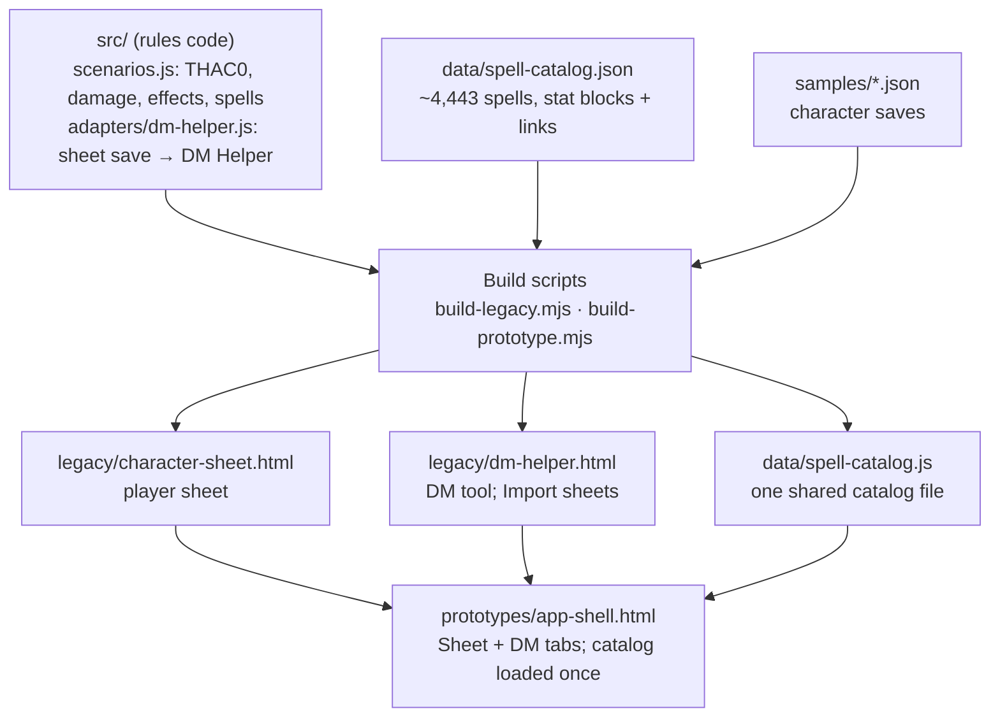

# AD&D Campaign App — Handoff

As of 2026-10-09. Written for whoever picks this up next, in a local Claude Code
session or by hand. The same content (with a drawn diagram) is in the shared
doc "AD&D Campaign App — Handoff":
https://claude.ai/code/artifact/1d9e5fb7-fc59-4166-86b5-4bef2667b01d

Contents:

1. [Project overview](#project-overview)
2. [Uploads and source material](#uploads-and-source-material)
3. [Where everything lives](#where-everything-lives)
4. [How it's built](#how-its-built)
5. [Decisions log](#decisions-log)
6. [Conversation history and context](#conversation-history-and-context)
7. [Every push](#every-push)
8. [Open items and next steps](#open-items-and-next-steps)
9. [Working agreements](#working-agreements)

---

## Project overview

The goal is a shared, private web app for a remote AD&D 2nd Edition group,
built from the owner's own Character Sheet and DM Helper. Each player keeps
their sheet. The DM's tool reads every character straight from the sheet's
saved JSON instead of hand-typed stats.

- **For players:** the character sheet, with a Combat section of attack
  scenarios and effects (stances, Bless) that work out THAC0 and damage.
- **For the DM:** the DM Helper (initiative, attacks, saves, proficiencies,
  reactions), now importing each sheet's details.
- **Not automated, by design:** abilities and proficiencies stay as text that
  players announce at the table.

**State on 2026-10-09:** both tools work standalone from disk and inside one
clickable preview with Sheet and DM tabs. The DM Helper reads Jaque's attacks,
rates, spells and effects from his sheet with the same math the sheet uses. The
cloud backend (accounts, shared database) has not started.

---

## Uploads and source material

The owner supplied two working tools, five character saves (one hand-built,
four converted from an Excel sheet) and a house-rules document. All are
committed to the repo.

| Upload | Repo path | What it is |
| --- | --- | --- |
| Character Sheet 2e Beta (index.html, ~7,000 lines) | `legacy/character-sheet.html` | The player sheet. Saves and loads through `gatherData()` / `applyData()`; has a `__version` + `migrateData()` upgrade step |
| DM Helper (~3,200 lines) | `legacy/dm-helper.html` | Initiative, attacks, crits, saves, proficiencies, reactions. PCs were hand-typed in a config block; a DM tab plus one tab per PC |
| Jaque save, 09-23 | `samples/jaque_09-23.json` | Elf Blade Bard 5, rebuilt by hand in the sheet. Weapons: Superior, Leprechaun, Wave Dagger, Dagger x6 |
| Atteroak save | `samples/atteroak.json` | Dwarf Cleric 4; converted from the Advanced D&D (Rev.) Excel sheet |
| Hanspeter save | `samples/hanspeter.json` | Human Bard 2 / Druid 5; converted; spells typed wizard (open item) |
| Nandun save | `samples/nandun.json` | Half-orc Barbarian 3 / Ranger 3; converted; Str 18, effectively 18/00 via "Ripped" (open item) |
| Tig save | `samples/tig.json` | Human Paladin 2 / Bard 5 (Tighkar Talenthos); converted |
| Revised Blade kit | `docs/house-rules/blade-revised.md` | House rules for Jaque's kit: Duelist's Precision, Signature Weapon (dagger), spins, Blade thief skills |

Derived files built from these:

- `samples/jaque_10-09.json`: Jaque's current save, generated by
  `scripts/convert-jaque.mjs` from the 09-23 save plus agreed fixes (thief kit
  Open Locks 20, daggers 1d3 vs Large, four scenarios, four effects).
- `docs/character-survey.md`: what the five saves show (converted weapon rows
  already hold final numbers; one row per way of using a weapon; unarmed as a
  weapon row).
- `docs/combat-data-spec.md`: the first combat data design (largely superseded
  by decision 23).
- `data/spell-catalog.json`: ~4,443 spells imported from the AD&D 2e wiki
  (adnd2e.fandom.com, CC BY-SA): stat blocks and links only, never description
  text.
- `generated/dm-helper-jaque.js`: a paste-in DM Helper block for Jaque from the
  earlier importer (the Config tab's Import sheets replaces this).

---

## Where everything lives

All work is on GitHub in the private repo `wmartin0103/app.adnd`, branch
`claude/vibrant-wozniak-gjkyjd`. No pull request has been opened.

| What | Where |
| --- | --- |
| Repo | https://github.com/wmartin0103/app.adnd (private) |
| Working branch | `claude/vibrant-wozniak-gjkyjd` |
| Clickable preview (Sheet + DM tabs) | https://claude.ai/artifact/8z3m1DfqCeoDmuB27kwxaV (private to the owner; built from `prototypes/app-shell.html`, with `data/spell-catalog.js` published beside it) |
| Handoff doc | https://claude.ai/code/artifact/1d9e5fb7-fc59-4166-86b5-4bef2667b01d |
| Cloud session | `session_01QtRv7WZwg5JMdLQxsfSbPS` (for `claude --teleport`) |
| The plan | `PLAN.md` (stack, roadmap, decisions 1–30, status) |

**Run it locally**

1. Install Node.js (LTS) and Claude Code: `npm install -g @anthropic-ai/claude-code`.
2. `git clone https://github.com/wmartin0103/app.adnd.git`, `cd app.adnd`,
   `git checkout claude/vibrant-wozniak-gjkyjd`.
3. Open `legacy/character-sheet.html` or `legacy/dm-helper.html` straight from
   disk. Keep the `data/` folder beside `legacy/`: both load
   `../data/spell-catalog.js`.
4. Continue with Claude: `claude --teleport` from that folder (in your own
   terminal, not in the chat), or a fresh `claude`.

**Build and test** (Node 20+, no install step)

- `npm test` runs 81 tests (node --test).
- `node scripts/build-legacy.mjs` copies `src/` into both legacy tools between
  the "sheet converter" markers and regenerates `data/spell-catalog.js`. Run
  after any change in `src/` or the catalog JSON; a test fails if you forget.
- `node scripts/build-prototype.mjs` rebuilds `prototypes/*.html` from the
  templates.
- Spell re-import: `scripts/import-wiki-spells.mjs` (needs network access to
  adnd2e.fandom.com; Node fetch behind a proxy needs `NODE_USE_ENV_PROXY=1`).

---

## How it's built

Game math lives once, in `src/`, and the build copies it into both tools, so
the sheet and the DM Helper always compute the same THAC0 and damage.

The tools stay plain HTML files that work from disk; the build pastes the rules
code between their "sheet converter" markers.

| File | What it does |
| --- | --- |
| `src/rules/scenarios.js` | Combat scenarios: "How it adds up" lines, THAC0, damage, spells, effects (stances, Bless) |
| `src/adapters/dm-helper.js` | Turns a sheet save into DM Helper entries: attacks, extra-attack rows, cast actions, AC, saves, skills, thief skills, damage, crit types |
| `src/rules/character.js`, `tables.js`, `spells.js` | AC, saving throws, thief skills, proficiency targets; PHB tables; catalog lookup by name or alias |
| `src/rules/attacks.js`, `combat.js`, `migrate.js` | Older v2-model code from before "back to basics"; still used for saves and skills (via the v1→v2 migration) |
| `scripts/bundle.mjs`, `build-legacy.mjs`, `build-prototype.mjs` | Bundle `src/` into the tools and the preview |
| `scripts/convert-jaque.mjs` | Rebuilds `samples/jaque_10-09.json` from the 09-23 save |
| `scripts/import-wiki-spells.mjs` | Rebuilds the spell catalog from the wiki; keeps hand-entered entries |
| `test/*.test.js` | 81 tests: rules, migration, importer, and that both tools and the catalog file are freshly built |

---

## Decisions log

Thirty decisions are recorded in `PLAN.md` section 8. Decision 23 ("back to
basics") reset the direction: it superseded 13–22, except the spell catalog.

| # | Decision | In force |
| --- | --- | --- |
| 1 | Repo is private | Yes |
| 2 | Every player actively uses the sheet tool | Yes |
| 3 | The sheet is the source of truth; the DM asks for, or makes, changes in the sheet | Yes |
| 4 | HP synced in real time between DM and player | Yes (future phase) |
| 5 | Players declare their own actions | Yes (future phase) |
| 6 | Players see each other's full sheets, view-only; owner, DM or admin grants edit access to run a character for a session, then revokes it; party view later | Yes |
| 7 | Sessions are remote over video; design for a half-width desktop window (600–900px), then tablet, then phone | Yes |
| 8 | Blade thief skills: only the four Blade skills; Locksmithing grants full Open Locks | Yes |
| 9 | App = Sheet, Combat and DM tabs sharing one character; DM tab only for DM users | Partly: Combat tab shelved (23) |
| 10 | Spoken declarations stay; no declare/lock step for now | Yes |
| 11 | Players see each other's exact HP and conditions | Yes (future phase) |
| 12–22 | Combat tab as a quick reference; foes list; players edit own HP; attacks per round toggle; combat layout; abilities "In combat" roles; weapon rows as final numbers; weapon parts and combat modifiers; abilities as reminders with adjusters | Superseded by 23 (except 19, the spell catalog) |
| 19 | One shared spell catalog for the campaign: stat blocks only, never book text | Yes |
| 23 | Back to basics: original sheet with confirmed fixes (priest THAC0, exceptional Str, racial weapon bonuses, Blade thief skills, Con save bonus); DM Helper as it was plus Import sheets; abilities and proficiencies announced, not automated; Combat tab shelved | Yes |
| 24 | Weapon row = the weapon only. A Combat Scenario = one way of attacking, carrying the character's bonuses (Hit Mod, Dmg Mod). Test: would someone else picking up the weapon get the bonus? | Yes |
| 25 | Stances & effects: one card per effect with one or more options (pick-one segmented control, or a switch for one option); Edit and Delete; temporary effects have From and Rounds left, counted down by Next round; apply to all attacks or one weapon | Yes |
| 26 | Scenarios: attack type Melee (Str hit and dmg), Thrown (Dex hit, Str dmg), Missile (Dex hit), Spell; PHB rates (1/1, 3/2 … 5/1); no "Only in", no form flag; spells fill from the catalog; touch uses Str, ranged Dex | Yes |
| 27 | Weapon values are fixed-choice dropdowns with "?" for unrevealed; one-time tidy of free text; size-based bonuses become an Effect (Wave Dagger) | Yes |
| 28 | Import ~4,400 wiki spells; attack roll and dice guessed and marked "check" | Yes |
| 29 | DM Helper reads the Combat section through shared math; effects that are on count and are listed for the DM | Yes |
| 30 | No magic concept: bonuses are just Hit · Dmg adj; a critical multiplies the whole damage. One shared catalog file. Spell damage caps wait | Yes |

Smaller calls made along the way, all in force:

- Section names: "Combat Scenarios" is now **Combat**; the original stat-card
  "Combat" section is **Character Details**. Effects sit at the top of Combat,
  collapsible, with what's on and the AC in the header.
- "How it adds up" columns only need to line up visually (left-aligned is fine).
- Dmg Type labels: Slash / Pierce / Blunt. The scenario weapon dropdown shows
  plain names, no "(Hit +1)".
- Daggers do 1d3 against Large targets.
- A "?" adjustment means there is an effect not yet revealed: keep it;
  scenarios show "+ ?" and the DM Helper flags it.
- Spell names suggest from one list labelled by class and level; picking a
  priest spell makes the entry Priest; wiki variant names answer to the plain
  name.
- The spell catalog is one file (`data/spell-catalog.js`) loaded by both tools;
  in the preview, the page loads it once and the tabs borrow it.

---

## Conversation history and context

What was asked and what came of it, in order. The full reasoning behind each
decision is in `PLAN.md` section 8.

**2026-10-07: plan and foundations**

- The owner described the goal (one private app from the two tools) and shared
  the Character Sheet, the DM Helper and Jaque's save. A migration plan
  (`PLAN.md`) set the stack: plain HTML/JS modules, Supabase, Netlify or
  Cloudflare Pages, $0/month. The repo was made private.
- Review findings: the sheet's math reads straight from form fields, the DM
  Helper's PC data was hand-typed and had drifted from the sheet (e.g. "Magic
  Dagger +1" vs the sheet's four daggers).
- Decisions: HP sync, players declare their own actions, remote play on a
  tablet or desktop window beside the video call, admin-issued accounts, a
  reference library (PHB, Monstrous Manual).
- Built: the shared rules module with tests, a v1→v2 save migration, the
  revised Blade kit rules, the sheet → DM Helper converter and the DM Helper's
  Import sheets, and a Weapons & Combat design prototype.

**2026-10-08: the Combat tab experiments**

- An app-shell prototype with Sheet, Combat and DM tabs. The Combat tab went
  through several designs: party HP, foes, a Standard / Bonus round toggle,
  ability "In combat" roles, then "Combat as a reference".
- Four more saves arrived (Atteroak, Hanspeter, Nandun, Tig). The survey showed
  converted weapon rows already hold final numbers, so the v2 rules counted
  Strength and non-proficiency twice.
- A shared spell catalog was started from the spells in the saves.

**2026-10-09: back to basics, then building on it**

- The owner asked to go back to basics: the DM tool should read character info
  straight from the sheet JSON, and abilities are announced, not automated. The
  sheet was restored to its original plus confirmed fixes; the Combat tab was
  shelved; the preview kept only Sheet and DM tabs.
- Workshopped where bonuses belong: the weapon row is the weapon only;
  scenarios carry the character's bonuses ("who does the bonus belong to").
  Jaque attacks three ways (melee, thrown, off-hand), so a scenario is an
  attack choice, not a weapon choice.
- Stances & effects were designed: Bladesong as one card with options (styled
  like the original Bladesong segmented row), a temporary Bless from Atteroak,
  Edit and Delete, collapsible at the top of Combat.
- Scenario refinements: PHB rates (3/2, 3/1), no "Only in", spells as attacks;
  weapon rows got fixed-choice dropdowns; Wave Dagger's size bonuses became an
  Effect; "How it adds up" was aligned.
- The owner asked for a spell database so scenarios auto-populate. After the
  wiki domain was allowed, ~4,400 spells were imported. Bless seemed missing;
  the cause was a per-class suggestion list, fixed with one labelled list and
  alias matching.
- Adding a memorized spell now updates scenario spell dropdowns.
- The DM Helper importer was rewritten around scenarios via shared math (Jaque's
  thrown THAC0 14, not 17).
- Magic bonuses: first "keep them separate" (a Magic column), then the owner
  noted both daggers are magic with no damage bonus, and the magic concept was
  dropped entirely.
- The owner asked to centralize the catalog: one shared file instead of a copy
  per tool.
- A "?" weapon adjustment means an effect not yet known; it stays.
- The DM Helper's Initiative order table was misaligned; fixed.
- Moving off the cloud session: run `claude --teleport` in your own terminal
  (typed into the chat it does nothing).
- This handoff was written as a shared doc, then as this file.

---

## Every push

All 64 commits on `claude/vibrant-wozniak-gjkyjd` before this handoff, oldest
first, plus the commit that adds this file.

| # | Date | Commit | What changed |
| --- | --- | --- | --- |
| 1 | 2026-10-07 | `ab4854a` | Add migration plan for combined campaign web app |
| 2 | 2026-10-07 | `003bdbe` | Update plan with findings from existing character sheet and DM Helper |
| 3 | 2026-10-07 | `9ef9d5d` | Add existing character sheet, DM Helper, and a sample save |
| 4 | 2026-10-07 | `d46cd92` | Add combat data spec; record HP sync and player declaration decisions |
| 5 | 2026-10-07 | `f689e1a` | Revise combat spec: combined weapons/attacks, layered modifiers, dice roller, declaration flow |
| 6 | 2026-10-07 | `c6491d0` | Record hit/miss and initiative visibility decisions in combat spec |
| 7 | 2026-10-07 | `37951e1` | Add rules functions for weapons and attacks, with tests |
| 8 | 2026-10-07 | `2c30b48` | Fix priest THAC0, add exceptional strength, apply racial weapon bonuses |
| 9 | 2026-10-07 | `282a9a4` | Add v1 → v2 sheet migration with review list |
| 10 | 2026-10-07 | `9eee1e6` | Record remote-play device decision: tablet/desktop beside video call, phone supported |
| 11 | 2026-10-07 | `96e48ed` | Plan: player combat view is on their own screen, not a phone |
| 12 | 2026-10-07 | `893f526` | Spec: describe current dice roller and plan to match it |
| 13 | 2026-10-07 | `3e9515a` | Spec: default roller name Jim Darkmagic; drop dice-style option |
| 14 | 2026-10-07 | `e111549` | Plan: admin-issued accounts, cloud source of truth, reference library |
| 15 | 2026-10-07 | `7ed698b` | Plan: reference library covers the PHB and Monstrous Manual |
| 16 | 2026-10-07 | `80620a4` | Model the revised Blade: Duelist's Precision, off-hand attack, spins |
| 17 | 2026-10-07 | `cad1e67` | Signature Weapon applies to every dagger, off-hand included |
| 18 | 2026-10-07 | `813c902` | Flanking counts as flanked for Duelist's Precision; hide Blade PP/RL |
| 19 | 2026-10-07 | `e911fe2` | Blade Pick Pockets left open pending table ruling; fix 1% skill floor |
| 20 | 2026-10-07 | `e79f433` | Add sheet → DM Helper converter |
| 21 | 2026-10-07 | `cff79d2` | Add Import sheets to the DM Helper |
| 22 | 2026-10-07 | `375e28b` | Blade thief skills: only Blade skills, plus Open Locks via Locksmithing |
| 23 | 2026-10-07 | `3cafb33` | Sheet: dwarf/gnome/halfling Con save bonus follows the PHB |
| 24 | 2026-10-07 | `5ed93f5` | Add Weapons & Combat design prototype |
| 25 | 2026-10-07 | `df10fa7` | Prototype: inline labels on attack rows instead of column headers |
| 26 | 2026-10-07 | `4e3bd5d` | Prototype: icons + labels decided; drop base weapon from subtitle |
| 27 | 2026-10-07 | `d68c656` | Combat: declare the round, then make each attack separately |
| 28 | 2026-10-07 | `a7925e5` | Off-hand attacks from any weapon; weapon proficiency penalties |
| 29 | 2026-10-08 | `baaff3e` | Add app shell prototype: Sheet, Combat, DM tabs |
| 30 | 2026-10-08 | `bf7a8d6` | App shell: exact party HP; Quick reference in Combat |
| 31 | 2026-10-08 | `c9ed8c2` | Sheet: weapon detail line and proficiency weapon types |
| 32 | 2026-10-08 | `525b3f6` | Sheet: weapon settings behind a gear; dropdowns for speed, adj, damage |
| 33 | 2026-10-08 | `6fe163d` | Sheet: compact weapon row that fits its container |
| 34 | 2026-10-08 | `b535035` | Combat reads weapons from the sheet; AC table and target notes; drop sheet scenarios |
| 35 | 2026-10-08 | `8d41706` | Combat: foes that are down stay listed, greyed and last |
| 36 | 2026-10-08 | `6804ce0` | Combat: players change their own HP |
| 37 | 2026-10-08 | `29ad97b` | HP below 0: unconscious, dying, dead at -10 |
| 38 | 2026-10-08 | `262b755` | Combat: current HP is edited in place |
| 39 | 2026-10-08 | `3dc3f6f` | Combat: HP input looks like the plain number again |
| 40 | 2026-10-08 | `54fe33b` | Combat: Standard / Bonus round toggle instead of counting attacks |
| 41 | 2026-10-08 | `a9d0f98` | Combat mock-up: round setup and one card per attack |
| 42 | 2026-10-08 | `50507cd` | Abilities: an In combat setting on each ability card, and an Ability round choice |
| 43 | 2026-10-08 | `c9108c1` | Add four more character saves and a survey of what they show |
| 44 | 2026-10-08 | `0a82cd2` | Shared spell catalog: stat blocks for every spell in the saves, used by Cast |
| 45 | 2026-10-08 | `7d9f09d` | Combat as a reference: options and what to roll, no targets or dice |
| 46 | 2026-10-09 | `318a61a` | Weapon rows as totals made of parts; combat modifiers replace Jaque-only rules |
| 47 | 2026-10-09 | `1317cd8` | Abilities as reminders with adjusters instead of combat modifiers |
| 48 | 2026-10-09 | `89493cf` | Back to basics: original sheet with confirmed fixes; Sheet and DM tabs only |
| 49 | 2026-10-09 | `f2cc318` | Sheet: scenarios carry the character's bonuses; Stances & effects |
| 50 | 2026-10-09 | `d046ddc` | Stances: one card per stance with its own options; visible Delete |
| 51 | 2026-10-09 | `47295c4` | Stances: pick-one control styled like the Combat prototype's Bladesong row |
| 52 | 2026-10-09 | `48d1173` | Sheet: Combat section with collapsible Effects first; scenarios show how numbers add up |
| 53 | 2026-10-09 | `de2d045` | Sheet: rename the stat cards section to Character Details |
| 54 | 2026-10-09 | `f5a729d` | Scenarios: PHB attack rates, no Only in, spells as attacks |
| 55 | 2026-10-09 | `7f53168` | Weapons: fixed-choice values the scenarios can rely on; narrower Dmg Type |
| 56 | 2026-10-09 | `9433379` | Scenarios: weapon dropdown lists plain weapon names |
| 57 | 2026-10-09 | `a01ac7e` | Import ~4,400 spells from the AD&D 2e wiki into the spell catalog |
| 58 | 2026-10-09 | `e5bf181` | Spells: one labelled suggestion list, alias matching, filled placeholders |
| 59 | 2026-10-09 | `da0af09` | Sheet: scenario spell list follows memorized spells |
| 60 | 2026-10-09 | `ac08390` | DM Helper reads the sheet's Combat section through shared scenario math |
| 61 | 2026-10-09 | `f750876` | One shared spell catalog file for the sheet and the DM Helper |
| 62 | 2026-10-09 | `0769306` | Weapons: separate Magic column, kept apart on criticals |
| 63 | 2026-10-09 | `afcd9fb` | Drop the magic concept from weapons |
| 64 | 2026-10-09 | `74ab6f3` | DM Helper: line up the Initiative order table |
| 65 | 2026-10-09 | (this commit) | Add handoff.md |

---

## Open items and next steps

The next build step is turning the other players' saves into Combat scenarios,
so their DM Helper rows come from their sheets the way Jaque's now do.

**Data questions to settle**

- [x] Goroth's (Nandun's) Strength: 18/00 (2026-10-09, now `samples/goroth_10-09.json`).
- [ ] Nandun's thrown attacks (Spear, Harpoon) are 3 worse than his Excel sheet: it added Str to hit, the app uses Dex (decision 26). Keep the app's rule?
- [ ] Nandun's Maul has +2 to hit with no stated source; kept as Hit Mod.
- [x] Hanspeter's spells are Priest (druid), spell class Priest (2026-10-09, `samples/hanspeter_10-09.json`).
- [ ] Hanspeter's Light: assumed druid; confirm with the player (flagged in its notes).
- [x] Tig: rebuilt on PHB values, since he isn't being played (2026-10-09, `samples/tig_10-09.json`). Kept his written Skilled +1 and Expertise 3/2; Code of Gallant is an Effect.
- [ ] Atteroak: Horseman's Mace +1 does 1d6+2 vs both sizes (PHB 1d6/1d4, +1 magic); sling stones −2 vs bullets −3; warhammer 1d4+1 vs Large (PHB 1d4).
- [ ] Hanspeter's weapons: two unnamed "Other (Custom)" rows (animal forms?), and +1 hit on rows his Str 10 doesn't explain.
- [x] Rifiyr (2026-10-12): save added (`samples/rifiyr.json`, converted to
  `samples/rifiyr_10-12.json`); Bowcaster kit in `docs/house-rules/bowcaster.md`.
  Bows with Mystic Aim (long bow THAC0 16, 2/1), −2 with anything else, and the
  casting penalty without an arrow are all worked out.
- [x] Rifiyr, Spellarrows (2026-10-12): a Spellarrow attack type on the sheet
  (bow + memorized spell) and a "bow + cast time" action
  in the DM Helper. Rifiyr's Shocking Grasp arrow: THAC0 16, arrow 1d8/1d6,
  spell 1d8+4, speed 8 + 1. Not automated: the delivery AC (the DM applies it).
- [ ] Rifiyr, to rule on: AC 4 or 6 (the sheet treats 6 as his bracers and
  subtracts Dex; bracers are allowed, ruled 2026-10-12); Read Magic is
  Divination, which the kit bans. Done 2026-10-12: he uses flight and sheaf
  arrows. Weapons now have a settings gear with "Uses Ammo?" (No, Arrows,
  Quarrels, Sling ammo, Blowgun ammo); an Ammunition list under Weapons
  (now "Special Ammunition", shown when a weapon uses ammo) holds only magic
  or unusual ammo, each with a type, dice and adjustments. An attack's Ammo
  always offers the PHB ammunition of the weapon's type (flight and sheaf
  arrows; hand, light and heavy quarrels; sling bullet and stone; barbed dart
  and needle), then the special ammo of that type; the weapon's and the
  ammo's bonuses add up. He has one attack per bow and arrow. Ruled 2026-10-12: only spells that fit a
  Spellarrow tier ride an arrow, so Melf's Acid Arrow is cast the ordinary way
  (with the penalty); the Ring of Spell Storing waits until he adds new spells.
- [ ] Borsun: no save yet; his DM Helper entry is hand-typed.
- [ ] Saves from every other active player (PLAN status list).
- [ ] Leprechaun Dagger damage stays "?" until the DM reveals the effect; then set the value or make it an Effect.

**DM Helper: one product with the sheet** (paused 2026-10-23, owner out of credits)

- [x] Step 1: the DM Helper uses the sheet's palette and type (light; tokens
  mapped onto its own names in its `:root`). Layout unchanged.
- [ ] Layout issues remain throughout the DM Helper after the re-skin; the owner
  will go through them next session (not yet listed). Expect many small fixes.
- [ ] Step 2: one shared source for tokens and components (labelled controls,
  the select with checkboxes, result panels, strips, collapsible sections),
  copied into both tools by the build like the rules. Basis for light/dark
  mode for both, a short-term goal.
- [ ] Step 3: the Initiative tab's structure from
  `prototypes/dm-initiative-mockup.html` (owner: "a fine place to start, will
  need work"): one order with Baddies in it, attacks as the sheet's cards,
  the DM's verdict in the result panel. Do it in pieces; start with how
  players' synced rounds show.

**Rules questions** (the owner is asking the table)

- [ ] Flanking vs Rear attack to-hit (asked 2026-10-23). Both are +2 in This round today
  (`ROUND_MODS` in `src/rules/round.js`: `flankingToHit`, `rearToHit`). Rear attack +2 is the PHB's
  attack-modifier table; Flanking +2 is the original DM Helper's table rule (no PHB flanking rule);
  Combat & Tactics is thought to give flank +1, rear +2 (unverified). Also open: whether a rear
  attack ignores the target's shield. Change both numbers in `ROUND_MODS`; the dropdown notes
  ("+2 to hit") are in the sheet's Conditions options.

**Product questions** (PLAN decisions 2, 3, 6; decided 2026-10-09)

- [x] Every player will actively use the sheet tool.
- [x] The sheet is the source of truth; the DM asks for, or makes, changes in the sheet.
- [x] Players see each other's full sheets, view-only. The owner, DM or an admin grants a player edit access to run a character for a session, then revokes it. A party view comes later.

**DM Helper import: found 2026-10-13** (see PLAN 1a for what the tool is for)

- [x] Character names (2026-10-13): his name is Goroth. His converted save is
  now `samples/goroth_10-09.json` (`scripts/convert-goroth.mjs`) and imports
  over the hand-typed Goroth, keeping the DM's settings.
- [x] Danger Sense (2026-10-13): added to Goroth's sheet (Wis +1: 13).
- [x] Skill names (2026-10-13): the import drops the Excel sheet's group code
  and book reference ("Intimidation G (DSDPH93)" → "Intimidation"), and skips
  proficiencies with no ability check ("Wild Fighting").
- [x] Goroth's Home Terrain skills (2026-10-13): Animal Lore 10, Hiding 9,
  Survival 10, Tracking 12 added to his sheet as Free, matching the DM's
  numbers (Animal Lore Int +0 and Hiding Int −1 chosen to match).
- [x] Goroth's proficiencies checked against the books on the 2e wiki
  (2026-10-13): all eight now match the DM's numbers. Running is Con −6 (PHB)
  and Dirty Tricks Wis −2 (Complete Gladiator's Handbook); the Excel
  conversion had dropped those adjustments.
- [x] Proficiencies checked against the books (2e wiki), 2026-10-13. Tig: book
  values (Persuasion −2, Style Analysis −1, Tactics −1, Local History on Cha).
  Hanspeter: Persuasion −2 (13), Foraging −2 (11). Atteroak
  (`samples/atteroak_10-13.json`): Healing −2 (16), Weaponsmithing (renamed
  to the PHB title) −3 on Wis under his "Experienced" craft rule (15). Those last four are where the book
  and the DM's hand-typed number agree.
- [ ] Owner to review: proficiencies where the save, the book and the DM's
  hand-typed number disagree. Until then the save's number is what imports.

  | Character | Proficiency | Save | Book | DM |
  | --- | --- | --- | --- | --- |
  | Hanspeter | Animal Lore | Wis 18 | Int +0 = 13 | 18 (Kit) |
  | Hanspeter | Musical Instrument | Wis 18 | Dex −1 = 10 | 16 (Kit) |
  | Hanspeter | Hunting | 18 | Wis −1 = 17 | 16 |
  | Hanspeter | Camouflage | 18 | Wis +0 = 18 | 17 |
  | Atteroak | Armorer | 18 | Wis (Experienced) −2 = 16 | 15 |
  | Atteroak | Animal Handling | 18 | Wis −1 = 17 | 16 |
  | Atteroak | Cooking | 18 | Wis (Experienced) +0 = 18 | 17 (Gift) |
  | Atteroak | Artistic Ability | Cha 11 | Wis +0 = 18 | 11 |
  | Atteroak | Endurance | 16 | Con +0 = 16 | 14 |
  | Atteroak | Religion | 18 | Wis +0 = 18 | 17 |
  | Atteroak | Bargain | 18 | not found on the wiki | 15 |

  Skills the DM rolls that don't reach the import: Hanspeter's Herbalism
  isn't on his sheet, and his Homeopathy and Naturopathy have no ability set.
- [x] Tig's proficiencies (2026-10-13), on book values: all 18 now import.
  Abilities set for Dancing, Languages Ancient, Poetry, Riding (renamed
  "Riding, Land-based"), Jousting and Storytelling; Enamour Cha −2 (Complete
  Ninja's, as "Enamor"); Musical Instrument and Singing added.
- [x] Proficiency names (2026-10-13): the Excel sheet's group codes and book
  references are removed from the converted sheets too
  (`scripts/tidy-names.mjs`), so names read the same on the sheet and in the
  DM Helper.

**Known gaps, deliberately deferred**

- Spell damage caps: done 2026-10-09 for the DM Helper. 26 per-level spells
  have `diceMaxLevel` in the catalog (Fireball and Lightning Bolt 10, Chain
  Lightning 12), read from the wiki with `import-wiki-spells.mjs --caps`. Not
  handled: caps the wiki words some other way.
- Caster level (2026-10-09): spells use the level of the class that casts
  them (PHB: Hanspeter's druid spells at 5, bard spells at 2; paladin −8,
  ranger −7), and a Blade casts two levels lower (Jaque: 3). The sheet and the
  DM Helper both show the worked-out dice ("Damage at level 3: 1d8+3"), and
  "1d8 per 2 levels" dice work too. (The scenario Level Source dropdown was
  removed 2026-10-12: levels come from the classes.)
  To check in the PHB: whether paladin/ranger casting level stops at 9.
- House-rule kits (2026-10-12): each class has a settings gear with a
  "Custom Kit Rules" select (None, Blade, Bowcaster; `src/rules/kits.js`). It
  turns on the kit's rules (Blade: casts two levels lower; Bowcaster:
  Spellarrows and the casting penalty).
  Players with standard kits leave it on None. Older saves without the
  setting go by the class name.
- House rule: the PHB's racial limits on multi- and dual-classing don't
  apply; a character listing several classes is multi-classed (PLAN 32).
- The preview viewer blocks file downloads, so the sheet's save-to-file button
  does nothing there; it works in the standalone file.
- The DM Helper's "effects on" line is a snapshot from the last import: a
  player turns Bless off when it expires, and the DM re-imports.
- Checked 2026-10-09: with the catalog as a separate file, typing "Bless"
  still offers "Priest · Level 1", and both tools share the page's one copy.

**Roadmap after that** (PLAN section 7)

1. Phase 1: put it online (Cloudflare Pages), behind Cloudflare Access. The
   repo side is ready (2026-10-09): `site/index.html` landing page and
   `npm run build` → `dist/`. The owner's account steps are in `docs/deploy.md`.
2. Phase 3: Supabase accounts and cloud saves; admin-issued temporary
   passwords; the catalog moves into the database. A database draft, not
   yet run or reviewed, is in `supabase/migrations/` (tables, view/edit/grant rules,
   version history, "changed since you opened it").
3. Phases 4–5: encounters in the cloud, then live table play (player combat
   view, HP sync).
4. Phase 6: reference library (PHB, Monstrous Manual) with mechanics and short
   summaries, no book text.

---

## Working agreements

The owner is a UX professional who works in HTML and CSS: be direct, explain
JavaScript as you would to a UX peer working beside an engineer, and suggest
changes when a design would hurt semantic, accessible markup.

- **Show, then confirm.** Visual changes are checked in a browser (Playwright
  screenshots) and republished to the preview before reporting.
- **Numbers never change by accident.** Before any refactor of the math, record
  every sample's THAC0 and damage with each effect toggled, and compare after;
  the tests also pin Jaque's values.
- **One source of truth.** Game math lives in `src/rules/` and is copied into
  the tools by the build script; never hand-edit between the "sheet converter"
  markers. The spell catalog is edited as JSON, then rebuilt.
- **Copyright.** Store mechanics, short summaries and links; never book or wiki
  description text.
- **Git.** Work on `claude/vibrant-wozniak-gjkyjd`; push after each finished
  change; no pull request unless asked. Commit messages end with the
  Co-Authored-By and Claude-Session lines; no model names in commits or files.
- **Data is the owner's.** Don't guess character facts (which weapons are
  magic, Str 18/00); ask, and leave saves unchanged until told.
